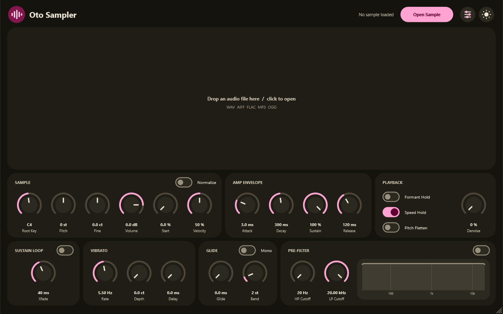

# OtoSampler


> **Note:** This repository is a temporary fork/mitigation to support building and running OtoSampler on **macOS** (Universal `arm64` + `x86_64`: VST3, Audio Unit, and Standalone) while upstream is Windows-only.
>
> For the main README, full feature overview, and upstream updates, please refer to the original repository:
> **[tempma1n/OtoSampler](https://github.com/tempma1n/OtoSampler)**

## Building & Installing on macOS

### Requirements
- Xcode (or Apple Command Line Tools)
- CMake (3.25+)
- Git (used to fetch JUCE)
- Ninja (optional, for faster builds)

### Build & Install
```bash
./build.sh
./install.sh
```

- `./build.sh` builds Universal Binary (`arm64` + `x86_64`) bundles into `dist/`:
  - `dist/Oto Sampler.vst3`
  - `dist/Oto Sampler.component` (Audio Unit)
  - `dist/Oto Sampler.app` (Standalone)
  - Additional flags: `native`, `arm64`, `x86_64`, `debug`, `clean`, `xcode`
- `./install.sh` copies the VST3 and AU plugins into `~/Library/Audio/Plug-Ins/VST3` and `~/Library/Audio/Plug-Ins/Components`:
  - `--system`: install system-wide into `/Library/Audio/Plug-Ins` (run with `sudo`)
  - `--app`: also install the Standalone app into `~/Applications` (or `/Applications` with `--system`)

### macOS Shortcut Note
- On macOS, use `Cmd+click` (or `Ctrl+click`) on the waveform to add a narrow sustain loop around the clicked position. See the [original README](https://github.com/tempma1n/OtoSampler#readme) for all other features and shortcuts.

## License

[GNU Affero General Public License v3.0](LICENSE).
